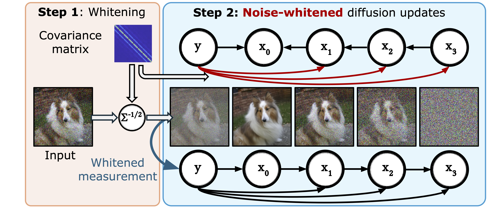

This repository contains the official implementation of **CARD: Correlation Aware Restoration with Diffusion**, presented at CVPR 2026.

[Project Page](https://ucr-vision-and-learning-group.github.io/CARD/) | [Paper](https://openaccess.thecvf.com/content/CVPR2026/papers/Nezakati_CARD_Correlation_Aware_Restoration_with_Diffusion_CVPR_2026_paper.pdf) | [arXiv](https://arxiv.org/abs/2512.05268) | [Supplementary Material](https://ucr-vision-and-learning-group.github.io/CARD/static/Supplementary.pdf) | [CIN-D Dataset](https://drive.google.com/drive/folders/1Yf4ts42ODvuhoi-ITnz8TpgEzReVpY5U?usp=sharing)

<p align="center">
  
</p>

CARD extends [DDRM](https://github.com/bahjat-kawar/ddrm) to solve linear inverse problems in the presence of spatially correlated Gaussian noise. Unlike methods that assume independent and identically distributed (i.i.d.) noise, CARD accounts for noise correlations by whitening both the observations and the forward operator before performing diffusion-based restoration. It uses frozen pretrained diffusion models and requires no task-specific training or fine-tuning.

We also introduce **CIN-D (Correlated Image Noise Dataset)**, a dataset of real camera images with spatially correlated sensor noise. CARD is evaluated on denoising, deblurring, and super-resolution with synthetic correlated noise, as well as real-noise restoration on CIN-D.

## Installation

Create and activate the Conda environment using the provided `environment.yml`:

```bash
conda env create -f environment.yml
conda activate ddrm
```

The supplied environment is inherited from DDRM and specifies Python 3.9, PyTorch 1.10.1, torchvision 0.11.2, and CUDA toolkit 11.3. A CUDA-capable NVIDIA GPU is recommended. On newer hardware, a compatible PyTorch/CUDA installation may be necessary.

## Pretrained Models and Datasets

CARD uses the same pretrained diffusion backbones as DDRM. No CARD-specific checkpoint is required.

Download the appropriate pretrained models from the original sources:

- [OpenAI Guided Diffusion](https://github.com/openai/guided-diffusion): ImageNet models.
- [PyTorch Diffusion](https://github.com/pesser/pytorch_diffusion): pretrained diffusion models, including LSUN models.
- [SDEdit](https://github.com/ermongroup/SDEdit): additional pretrained models used by DDRM.

See the [DDRM repository](https://github.com/bahjat-kawar/ddrm) for checkpoint preparation and the [DDRM demonstration datasets](https://github.com/jiamings/ddrm-exp-datasets) for example images.

The following illustrates the inherited DDRM directory layout. Place the data and checkpoints required by your selected configuration under the directory specified by `--exp` (or link them there):

```text
<exp>/
├── datasets/
│   ├── imagenet/
│   ├── celeba/
│   ├── ood/
│   ├── ood_bedroom/
│   ├── ood_cat/
│   └── ood_celeba/
├── logs/
│   ├── imagenet/
│   │   └── 256x256_diffusion_uncond.pt
│   ├── celeba/
│   │   └── celeba_hq.ckpt
│   └── diffusion_models_converted/
│       └── ema_diffusion_lsun_<category>_model/
│           └── model-x.ckpt
├── imagenet_val_1k.txt
└── image_samples/
```

Additional checkpoint files may be required depending on the configuration (e.g., for class-conditional sampling). For ImageNet benchmark evaluation, follow DDRM's setup for the 1,000-image validation subset.

## Running CARD

### General command

```bash
python main.py --ni \
    --config imagenet_256.yml \
    --doc imagenet_real \
    --timesteps 20 \
    --eta 0.80 \
    --etaB 1 \
    --deg deno \
    --sigma_0 0.01 \
    --exp card_deno \
    --noise_setting correlated \
    --noise_model corr_ddrm
```

CARD uses 20 sampling steps, with `eta=0.80` and `etaB=1`, in the reported sampling configuration.

### Arguments

| Argument | Description |
| --- | --- |
| `--config` | YAML configuration filename in `configs/`. |
| `--doc` | Experiment identifier; also used for the log directory and potentially dataset/checkpoint selection. |
| `--timesteps` | Number of diffusion sampling steps. |
| `--eta` | Sampling stochasticity parameter (0.80 in CARD experiments). |
| `--etaB` | Measurement-blending parameter (1 in CARD experiments). |
| `--deg` | Degradation operator; see below. |
| `--sigma_0` | Measurement-noise level supplied to the restoration algorithm. |
| `--noise_setting` | Noise setting: `correlated` or `iid`. |
| `--noise_model` | Restoration model: `corr_ddrm` (CARD) or `ddrm` (baseline). |
| `--exp` | Experiment root directory (default: `exp`). |
| `-i`, `--image_folder` | Output image folder name (default: `images`). |
| `--seed` | Random seed (default: 1234). |
| `--subset_start`, `--subset_end` | Optional evaluation subset indices. |
| `--ni` | Non-interactive mode; automatically overwrites an existing output image folder. |

### Restoration tasks

The degradation identifiers corresponding to the tasks evaluated in the paper are:

| Task | `--deg` |
| --- | --- |
| Denoising | `deno` |
| Uniform deblurring | `deblur_uni` |
| Gaussian deblurring | `deblur_gauss` |
| Anisotropic Gaussian deblurring | `deblur_aniso` |
| 2× super-resolution | `sr2` |
| 4× super-resolution | `sr4` |

### Example commands

The following commands use the ImageNet 256×256 configuration. The noise levels for deblurring and super-resolution illustrate synthetic-noise settings from the paper; adjust the dataset configuration and experiment root for your data.

**Denoising**

```bash
python main.py --ni --config imagenet_256.yml --doc imagenet_real \
    --timesteps 20 --eta 0.80 --etaB 1 --deg deno --sigma_0 0.01 \
    --exp card_deno \
    --noise_setting correlated --noise_model corr_ddrm
```

**Gaussian deblurring**

```bash
python main.py --ni --config imagenet_256.yml --doc imagenet \
    --timesteps 20 --eta 0.80 --etaB 1 --deg deblur_gauss --sigma_0 0.2 \
    --exp card_deblur_gauss --noise_setting correlated --noise_model corr_ddrm
```

**4× super-resolution**

```bash
python main.py --ni --config imagenet_256.yml --doc imagenet \
    --timesteps 20 --eta 0.80 --etaB 1 --deg sr4 --sigma_0 0.2 \
    --exp card_sr4 --noise_setting correlated --noise_model corr_ddrm
```

### Comparing with DDRM

To select the original DDRM baseline under correlated noise, set `--noise_model ddrm` while keeping `--noise_setting correlated`. Use a separate experiment root (e.g., `--exp ddrm_deno`) and keep the input data and degradation settings matched. For the original DDRM stochasticity setting, use `--eta 0.85`.

For i.i.d. noise experiments, set `--noise_setting iid`.

### Outputs

Following DDRM's naming convention, generated images are saved under:

```text
<exp>/image_samples/<IMAGE_FOLDER>/
```

- `orig_<id>.png`: original image.
- `y0_<id>.png`: degraded observation (or its visualization).
- `<id>_-1.png`: restored image.

With the default image folder, results are saved to `<exp>/image_samples/images/`. Use a different experiment root (`--exp`) for each experiment to avoid overwriting results. Each root must contain or link to the required datasets and checkpoints.

## CIN-D Dataset

[Download CIN-D](https://drive.google.com/drive/folders/1Yf4ts42ODvuhoi-ITnz8TpgEzReVpY5U?usp=sharing)

CIN-D contains 400 images across 100 scenes, with three noise levels and a long-exposure reference per scene, together with dark frames for covariance estimation. The data were captured using a FLIR Blackfly S color camera in indoor and outdoor environments with diverse lighting conditions.

The paper and supplementary material describe the acquisition protocol, covariance estimation, and real-noise evaluation. The dataset is also accessible through the [project page](https://ucr-vision-and-learning-group.github.io/CARD/).

## Citation

If you find our work or dataset useful in your research, please cite:

```bibtex
@inproceedings{nezakati2026card,
  title={CARD: Correlation Aware Restoration with Diffusion},
  author={Nezakati, Niki and Ghosh, Arnab and Roy-Chowdhury, Amit and Saragadam, Vishwanath},
  booktitle={Proceedings of the IEEE/CVF Conference on Computer Vision and Pattern Recognition},
  pages={16531--16540},
  year={2026}
}
```

## Acknowledgements

Our implementation builds upon [Denoising Diffusion Restoration Models (DDRM)](https://github.com/bahjat-kawar/ddrm). We thank the authors for making their implementation publicly available. We also acknowledge [Guided Diffusion](https://github.com/openai/guided-diffusion), [PyTorch Diffusion](https://github.com/pesser/pytorch_diffusion), and [SDEdit](https://github.com/ermongroup/SDEdit) for their publicly available code and pretrained models.
